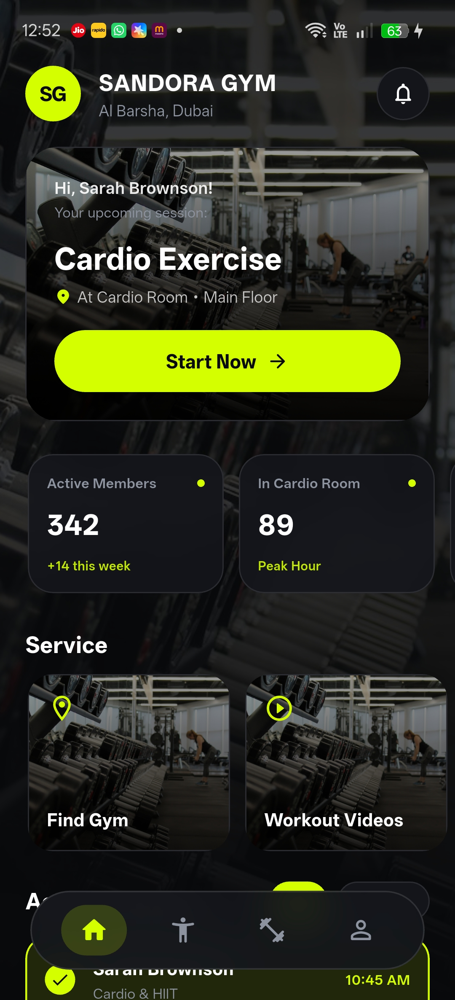
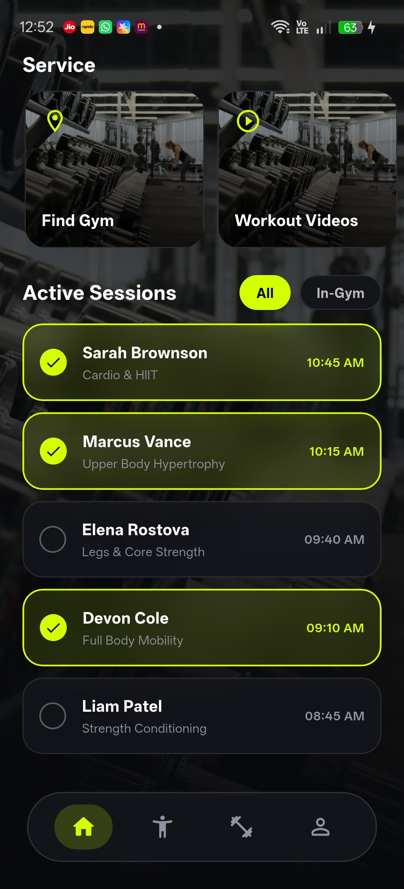
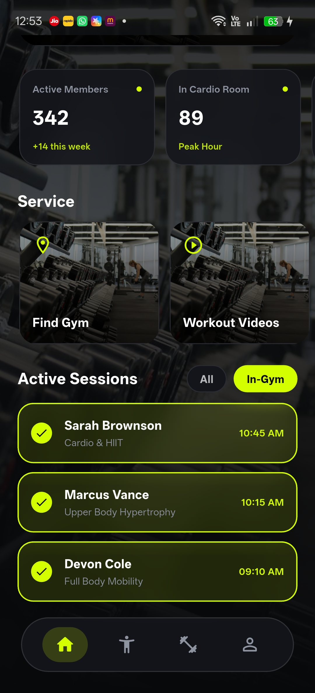
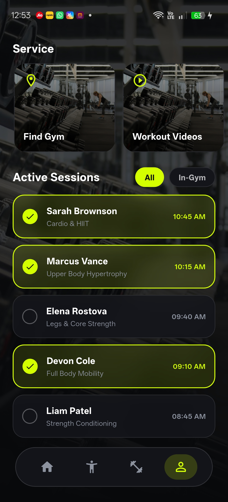
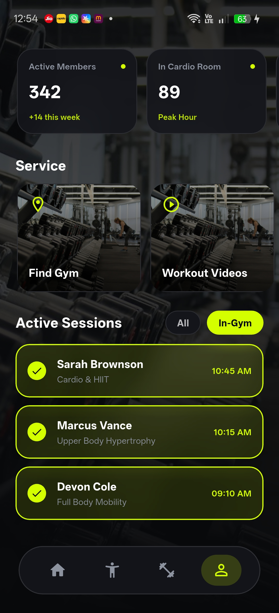
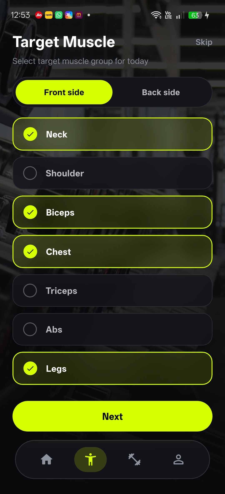
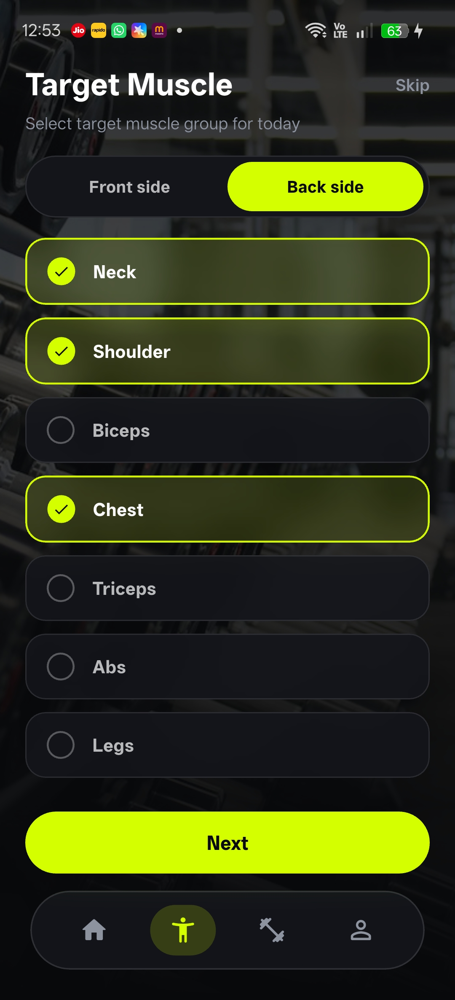
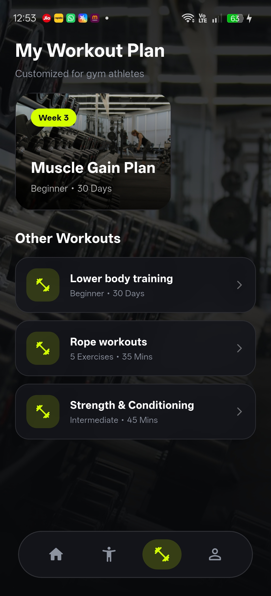

# 🏋️ Gym Management App — Flutter

A modern **Gym Management and Workout Planning App** built with Flutter and Dart. This project showcases a clean, fitness-focused mobile interface with gym services, workout sessions, user profiles, target muscle selection, and workout planning screens.

## 🎬 App Demo

  

  <a href="https://www.youtube.com/shorts/chFLPdDpp3k?feature=share">▶️ Watch the Full UI Demo on YouTube</a>

## 📱 Screenshots

### 🏠 Home Screen

  

### 🛠️ Gym Services

  

### 📅 Workout Sessions

  

### 👤 User Profile

  
  

### 💪 Target Muscle Selection

  
  

### 🏋️ Workout Plan

  

## ✨ Features

- Gym dashboard and home screen.
- Gym services interface.
- Workout and exercise screens.
- Workout session interface.
- User profile screens.
- Target muscle selection UI.
- Workout planning interface.
- Reusable and customizable Flutter UI components.
- Clean, fitness-focused mobile design.

*This feature list describes the screens showcased in this repository. Backend integrations and other functionality depend on the complete application implementation.*

## 🛠️ Technology Stack

- **Framework:** Flutter
- **Language:** Dart
- **UI:** Flutter widgets and Material Design

## 📚 Documentation

- [Features](docs/FEATURES.md)
- [Requirements](docs/REQUIREMENTS.md)
- [Setup Guide](docs/SETUP.md)
- [Demo Information](demo/demo-link.md)

## 📦 Source Code & Licensing

This public repository showcases the application's UI, screenshots, and documentation. The complete application source code is maintained in a separate private repository.

For source code licensing, customization, or commercial inquiries, please contact me through my GitHub profile.

## 👩‍💻 Developer

**Preeti Raut**

- GitHub: [@preetiraut](https://github.com/preetiraut)

---

  Built with ❤️ using Flutter

